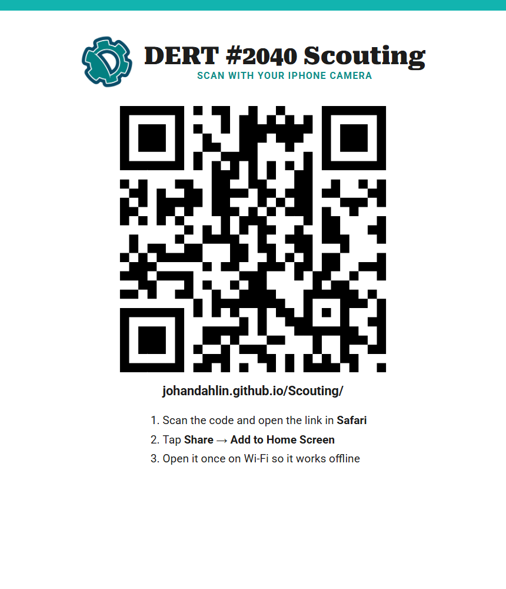
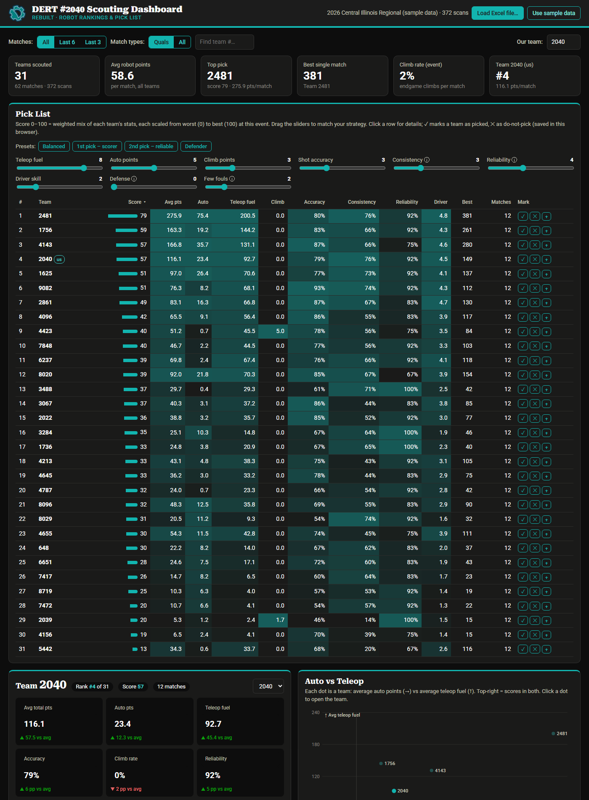

# Scouting with DERT #2040: from the stands to the pick list

**REBUILT 2026** · How to fill in the scouting form, scan QR codes into Excel and update the dashboard.

This is the text version of the training deck [DERT_Scouting_Training.pptx](DERT_Scouting_Training.pptx).

- [How our scouting works](#how-our-scouting-works)
- [Part 1 · Scouts: the scouting form](#part-1--scouts-the-scouting-form)
- [Part 2 · Data lead: scanning into Excel](#part-2--data-lead-scanning-into-excel)
- [Part 3 · Dashboard: from scans to a pick list](#part-3--dashboard-from-scans-to-a-pick-list)
- [Troubleshooting](#troubleshooting)
- [Event-day checklist](#event-day-checklist)

---

## How our scouting works

1. **Watch & record:** a scout watches one robot and fills in the form on a phone.
2. **Show the QR code:** after the match, the phone turns the answers into a QR code.
3. **Scan into Excel:** the data lead scans it. One row lands in the Excel workbook.
4. **Pick the best:** the dashboard turns all the rows into rankings and a pick list.

Each robot on the field has its own scout, so there are six scouts per match. No internet is needed in the stands.

### Who does what

| Role | How many | What they do |
|---|---|---|
| **Scouts** (Part 1) | 6 per match | Each scout watches one robot for the whole match and fills in the form. |
| **Data lead** (Part 2) | 1 per event | Has the laptop, the QR scanner and the Excel workbook. Scans every phone after each match. |
| **Strategy team** (Part 3) | Drive team & mentors | Loads the workbook into the dashboard and builds the pick list. |

---

## Part 1 · Scouts: the scouting form

For everyone in the stands: get the app, fill it in during the match, and hand over your QR code.

### Put the form on your phone

Do this before the event, on Wi-Fi.



1. **Scan the poster's QR code with your camera.** Or type `johandahlin.github.io/Scouting` in the browser.
2. **Open the link.** iPhone: Safari. Android: Chrome.
3. **Add it to your home screen.**
   - iPhone: Share → Add to Home Screen
   - Android: three-dot menu → Add to Home screen

   It shows up as **DERT Scout** and opens like a normal app.
4. **Open it once on Wi-Fi.** After that it works in the stands, even with no signal.

### Before the match starts

Fill in the **Pre-Match** card while the robots are being set up.

| Field | What to enter |
|---|---|
| **Match type** | Usually Qual. Stays for the next match. |
| **Match #** and **Team #** | From the schedule or the field screen. Red \* = must fill in. Double-check the team number: a wrong one puts the data on the wrong robot. |
| **Alliance** and **Station** | Your seat: Red or Blue, 1 to 3. Stays for the next match. |
| **Scout name** | Your name, so we know who to ask. Stays. |
| **Robot on field?** | Tap **No show** if the robot isn't there. |
| **Starting position** & **Fuel preloaded** | Where it starts (seen from your alliance's driver station) and how much fuel it holds. |

### How the buttons work

| Button type | How to use it |
|---|---|
| **Counters** (− 8 +1 +5 +10) | Tap +1, +5 or +10 to add. Tap − to take one away. |
| **Pick one** | Tap one answer. Tap it again to unselect it. |
| **Pick all that apply** | Tap every answer that happened. A ✓ shows what's selected. |
| **Required fields** (red \*) | Must be filled in. If one is empty you get a red box and no QR code. |

### During the match: watch only your robot

The match is 2:40 long:

```
0:00     0:20                                         2:10        2:40
 | AUTO  |                 TELEOP (2:20)                |  ENDGAME  |
```

| Part | When | What to record |
|---|---|---|
| **Autonomous** | First 20 sec | Fuel scored and missed · Its path: start line, Neutral Zone, Bump, Trench · Where it picked up fuel · Did it climb to Level 1? (15 pts) |
| **Teleop** | 2:20 | Fuel scored, **only while your Hub is active** · Fuel missed · Where it gets fuel and shoots from · What it does while the Hub is inactive · Defense: played it or received it |
| **Endgame** | Last 30 sec | Tower climb: None, Attempted, Level 1, 2 or 3 · How long the climb took |

> **Tip:** keep your eyes on the field. Tap +1 as each fuel goes in, and use +5 or +10 to catch up after a burst.

### After the match: rate it and add notes

Do this right after the buzzer, while you still remember.

1. **Ratings from 1 to 5:** driver skill, speed and accuracy. 1 = poor, 5 = great. Compare with the other robots you've seen today.
2. **Problems:** tap everything that went wrong: died, lost comms, tipped, jams…
3. **Fouls and cards:** count the fouls the refs called on this robot.
4. **Would you pick it?** Your gut feeling: Yes, Maybe or No.
5. **Observations:** write what a number can't show. This is the most valuable part for alliance selection.
   - Good: *"Fast shooter, always climbs L3."*
   - Not useful: *"good"*

Above the Submit button, black boxes add up the points for you (Auto, Teleop, Climb, Total). It's a quick way to spot a typo.

### Submit and show your QR code

1. **Tap Submit & show QR.** If something is missing, the form shows you what.
2. **Show the QR code to the data lead.** Turn your screen brightness up.
3. **Wait for "got it".** Keep the code on screen until it's scanned.
4. **Tap Next match.** Your name, alliance and station stay. Match # goes up by 1. Type the new Team #.
5. **Made a typo?** Tap **Back to edit**, fix it and submit again.

### Scout do's and don'ts

| ✅ Do | ❌ Don't |
|---|---|
| Watch only your robot, the whole match | Count fuel that went in while your Hub was inactive |
| Count fuel as it happens | Guess the team number. Check the schedule |
| Tap **No show** if the robot isn't on the field | Use **Clear form** unless you want to start over |
| Write real observations | Leave the stands without handing over your last match |
| Charge your phone before the event | |
| App closed? Reopen it. Your answers are saved | |

> ⚠️ **The #1 mistake:** tapping **Next match** before your QR code was scanned. That match is gone for good.

---

## Part 2 · Data lead: scanning into Excel

For the student with the laptop and the QR scanner. No Excel experience needed.

### What the data lead needs

| | |
|---|---|
| **Laptop with Excel** | Microsoft 365 or Excel 2021 or newer. |
| **QR code scanner** | USB or Bluetooth. It works like a keyboard. |
| **The workbook** | `DERT_Scouting_REBUILT.xlsx`. A fresh copy for each event. |
| **Charger and a seat** | Somewhere scouts can find you after every match. |

### What the scanner does

The scanner types the answers for you, one after the other, as if someone typed really fast:

```
Qual  [Tab]  12  [Tab]  1736  [Tab]  Blue  [Tab]  2  [Tab]  Alex  [Tab]  …  [Enter]
 A2           B2         C2           D2          E2         F2              next row
```

**Tab** moves one cell to the right. **Enter** goes to the next row. So **one scan = one row** in Excel.

### Excel in 60 seconds

Excel is a big grid. This is what the **Scans** sheet looks like:

| | A | B | C | D | E | F |
|---|---|---|---|---|---|---|
| **1** | **Match type** | **Match #** | **Team #** | **Alliance** | **Station** | **Scout name** |
| **2** | Qual | 12 | 8719 | Red | 1 | Ava |
| **3** | Qual | 12 | 8020 | Red | 2 | Ben |
| **4** | Qual | 12 | 2039 | Red | 3 | Chloe |
| **5** | ▢ ← *selected cell A5* | | | | | |

| Word | What it means |
|---|---|
| **Ribbon** | The menus at the top. You only need **File**, for the setup. |
| **Name Box** | The small box at the top-left. Shows which cell is selected, e.g. A5. |
| **Column letters** | A, B, C… across the top. Each answer has its own column. |
| **Row numbers** | 1, 2, 3… down the side. Each scan becomes one row. |
| **Cell** | One box. A5 = column A, row 5. The green border shows where the cursor is. |
| **Sheet tabs** | At the bottom. Switch pages here: Instructions, Scans, Team Summary, Team Lookup. |

### Set up Excel once, before the event

Do this once on each laptop.

1. **If you see a yellow PROTECTED VIEW bar, click Enable Editing.** Excel blocks typing and scanning until you do.
2. **Click File → Options → Advanced.** File is the first menu at the top-left.
3. **Untick "Enable AutoComplete for cell values".** It's under *Editing options*.
4. **Click OK.** Done. Excel remembers this on this laptop.

> **Why?** With AutoComplete on, Excel may finish a scanned word for you: *Depot* becomes *"Depot; Outpost"*, and the data is wrong without anyone noticing.

### Test the scanner in Notepad

Test in Notepad first, where nothing can go wrong.

1. **Open Notepad.** Click Start, type Notepad, press Enter.
2. **Make a test QR code.** On a phone: fill in a Practice match and tap Submit & show QR.
3. **Scan it.** Point the scanner at the phone and pull the trigger.

You should see something like this:

```
Practice   1   1736   Blue   2   Alex   Yes   Center   8   8   2   …
|
```

| What you see | What it means |
|---|---|
| ✅ Gaps between the answers | Those are Tabs. Good. |
| ✅ The cursor jumps to a new line | That's Enter. Good. |
| ❌ Strange letters or symbols | Set the scanner's keyboard language to match Windows (see its manual). |
| ❌ Nothing appears | Check the cable or Bluetooth pairing, and that the scanner is in keyboard mode. |

### Scan a QR code into Excel

This is the whole job during the event.

1. **Click the Scans tab** at the bottom of the window.
2. **Click the first empty cell in column A** (in the example above, A5). Always column A!
3. **Scan the phone.** Point the scanner at the QR code and pull the trigger.
4. **Watch the row fill in.** The cursor jumps to the next row by itself. Ready for the next phone.

> 💾 **Save every few scans:** `Ctrl + S`

### Fixing mistakes

| Problem | Fix |
|---|---|
| **Scanned into the wrong place?** | Press `Ctrl + Z` right away. It undoes the last scan. |
| **A bad row, or scanned twice?** | Right-click the grey row number → **Delete**. Then scan that QR code again. |
| **Answers in the wrong columns?** | The cursor wasn't in column A. Delete the row, click column A, scan again. |

> ⚠️ **Never change the teal header row.** Excel and the dashboard find the data by those names.

### See the results in Excel

You never type anything on these two sheets. They update by themselves after every scan.

- **Team Summary:** one row per team with averages (auto, teleop fuel, climb, total points, best match). Cells are coloured red → green: green is better. More columns and a pick list sorted by average points are further right on the sheet.
- **Team Lookup:** type a team number in the **yellow cell** (B3) and press Enter to see every scan of that team, with all the notes.

---

## Part 3 · Dashboard: from scans to a pick list

For the strategy team: load the workbook into the dashboard and rank the teams your way.

### Update the dashboard

1. **Save in Excel:** press `Ctrl + S`. The dashboard reads the saved file, not what's on screen.
2. **Open the dashboard:** tap **Dashboard** at the top of the scouting form, or go to `johandahlin.github.io/Scouting/dashboard.html`. No internet? Open `dashboard.html` from the Scouting folder.
3. **Click Load Excel file…** and choose the workbook. You can also drag the file onto the page.
4. **Check the count:** the top bar shows the file name and how many scans it read.

> 🔄 **It doesn't refresh by itself.** After new scans: save in Excel, then click **Load Excel file…** again.



### Read the pick list

Every team gets a score from 0 to 100.

1. **Presets:** 1st pick scorer, 2nd pick reliable, or defender.
2. **Sliders:** drag to say what matters most. The list re-sorts.
3. **Score 0–100:** each stat is scaled from the worst (0) to the best (100) team at this event, then mixed using the slider weights.
4. **Marks:** ✓ picked, ✕ do not pick, + add to Compare. Saved in this browser.
5. **Click a row:** opens that team's details below.

> **Before alliance selection:** load the newest file, pick a preset, then move the sliders until the list matches what our robot needs from a partner.

### Look closer at one team

Click a team in the pick list to open its card.

1. **Compared to the event:** ▲ better or ▼ worse than the average team.
2. **Points per match:** getting better? One bad match? Scout notes are listed under the chart.
3. **Auto vs Teleop:** each dot is a team. Top-right = strong in both. Click a dot to open that team.
4. **Compare Teams:** tap **+** in the pick list on up to 3 teams to see them side by side.

---

## Troubleshooting

| If this happens… | Do this |
|---|---|
| **The scanner won't read the QR code** | Turn the phone's brightness up, hold it 10 to 20 cm from the scanner, and keep it still. |
| **Answers landed in the wrong columns** | The cursor wasn't in column A. Delete the row, click column A, scan again. |
| **The scan typed into another window** | The scanner types wherever the cursor is. Click into Excel first, then scan again. |
| **Odd letters or symbols in the cells** | Set the scanner's keyboard language to match Windows (see its manual). |
| **Excel changed a word** (Depot → Depot; Outpost) | AutoComplete is on. Turn it off and scan that row again. |
| **Can't type or scan; yellow bar at the top** | Click **Enable Editing**. |
| **Dashboard: "no 'Team #' column"** | Load the DERT workbook. Don't rename or move the teal headers on the Scans sheet. |
| **Dashboard doesn't show the newest matches** | Save in Excel (`Ctrl + S`), then click **Load Excel file…** again. |

When in doubt: delete the row and scan again. The phone keeps the QR code until the scout taps Next match.

---

## Event-day checklist

**Before the event**

- [ ] App on every scout's phone, opened once on Wi-Fi
- [ ] Laptop and scanner charged
- [ ] AutoComplete off, scanner tested in Notepad
- [ ] A fresh copy of the workbook

**During matches**

- [ ] Scan every QR code right after the match
- [ ] Expect 6 QR codes per match: find any missing scout
- [ ] Save with `Ctrl + S` every few scans

**Alliance selection**

- [ ] Save, then **Load Excel file…** in the dashboard
- [ ] Pick a preset and adjust the sliders
- [ ] Mark teams ✓ or ✕ as they get picked
